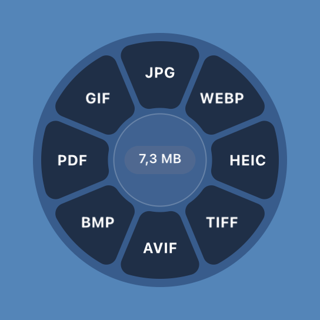
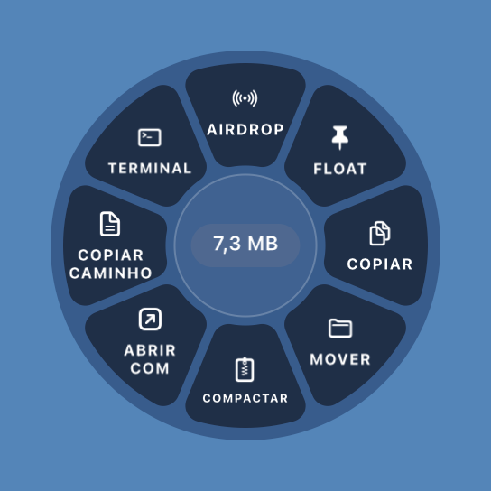
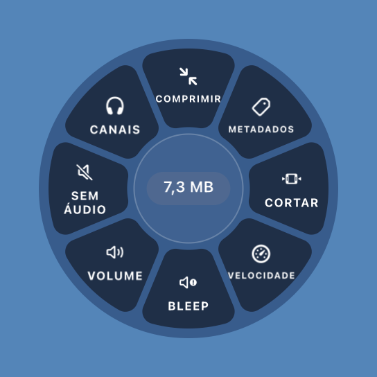
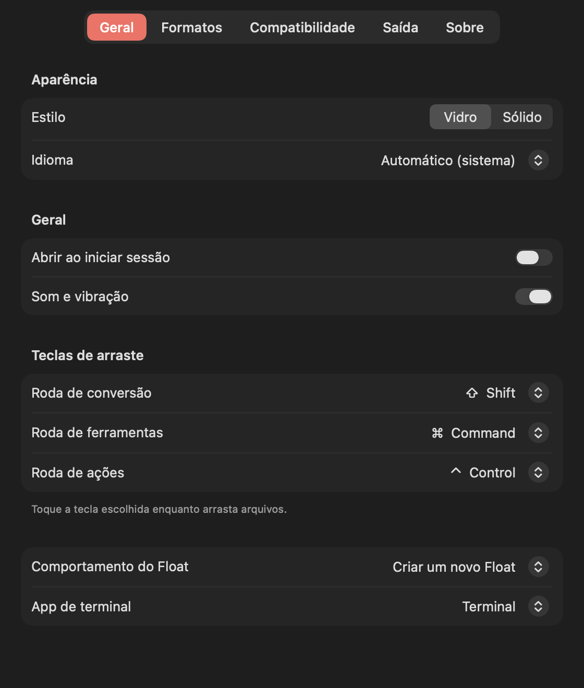

# Toranja 🍊

**Converta, comprima e organize arquivos sem soltar o mouse.** Utilitário gratuito e de código aberto
para a barra de menus do macOS. Tudo roda no seu Mac: sem conta, sem assinatura, sem internet.

[English](README.en.md) · [Baixar](https://github.com/EdilsonBorba/toranja/releases/latest) · [Novidades](CHANGELOG.md)

<p align="center">
  
  
  
</p>

## Como funciona

Comece a arrastar um ou mais arquivos e, **sem soltar**, toque uma tecla. Uma roda aparece ao lado do
cursor. Solte os arquivos na fatia que quiser.

| Tecla | Roda | O que faz |
|---|---|---|
| ⇧ Shift | **Converter** | Imagens (JPG, PNG, HEIC, WebP, AVIF, TIFF, BMP, GIF, PDF, SVG) · vídeo (MP4, MOV, WebM, MKV, GIF) · áudio (MP3, M4A, WAV, FLAC, AIFF, Opus) · documentos (Word, Pages, PDF, Markdown, HTML, EPUB, RTF, TXT) · planilhas (Excel, Numbers, ODS, CSV, TSV) · apresentações (PowerPoint, Keynote) · PDF → Word, Pages, PowerPoint, Excel, imagens |
| ⌃ Control | **Ações** | AirDrop · Float (prateleira flutuante) · copiar · mover · compactar/extrair · abrir com · copiar caminho · abrir no Terminal |
| ⌘ Command | **Ferramentas** | Comprimir · remover metadados · anotar · tarjar (sólido ou desfoque) · trocar/remover fundo · colagem · redimensionar · girar · ler QR code · organizar, separar e juntar PDF · cortar · velocidade · bleep · volume · canais · cortar silêncio · visualizador de áudio |

As rodas mostram só o que faz sentido para os arquivos arrastados. Os resultados são salvos ao lado do
original (ou numa pasta à sua escolha). **Nada é sobrescrito.**

## Instalar

1. Baixe o `Toranja-…-AppleSilicon.zip` mais recente em [Releases](https://github.com/EdilsonBorba/toranja/releases/latest).
2. Abra o zip e arraste o **Toranja** para a pasta **Aplicativos**.
3. **Na primeira vez**, clique com o botão direito no app → **Abrir** → **Abrir**.
   O Toranja não é assinado com uma conta paga de desenvolvedor da Apple, então o macOS pede essa
   confirmação uma única vez. Se aparecer *"está danificado"* ou não houver o botão Abrir, rode no Terminal:
   ```sh
   xattr -dr com.apple.quarantine /Applications/Toranja.app
   ```
4. O 🍊 aparece na barra de menus. Pronto.

**Requisitos:** macOS 14 (Sonoma) ou mais novo, Mac com chip Apple (M1 ou mais novo).
Não precisa instalar mais nada: o ffmpeg e um Java enxuto já vão dentro do app.
Só apresentações OpenDocument (`.odp`) precisam do [LibreOffice](https://www.libreoffice.org).

**Conferir o download (opcional):** cada versão traz um `SHA256SUMS.txt`.
```sh
shasum -a 256 Toranja-*-AppleSilicon.zip
```

## Ajustes

Menu 🍊 → **Ajustes…** (⌘,)

<p align="center"></p>

- **Geral:** vidro ou sólido, idioma (português/inglês), abrir ao iniciar sessão, sons, qual tecla abre cada roda, comportamento do Float, app de terminal.
- **Formatos:** qualidade e metadados (EXIF, GPS) de cada formato de saída.
- **Compatibilidade:** força da compressão de imagens, vídeo e áudio, tamanho máximo e tamanho alvo.
- **Saída:** salvar ao lado do original ou numa pasta fixa; mostrar no Finder ao terminar.

## Privacidade

O Toranja não se conecta à internet, não coleta dados e não precisa de permissões especiais. Ele
percebe o arrasto lendo a área de arrasto do sistema e as teclas modificadoras. Não monitora o teclado.

## Compilar a partir do código

Requisitos: macOS 14+, Xcode Command Line Tools (`xcode-select --install`), um JDK 11+
(ex.: `brew install --cask temurin`), Node.js e `brew install pkgconf cmake`.

```sh
git clone https://github.com/EdilsonBorba/toranja.git && cd toranja
./build.sh           # gera build/Toranja.app
./build.sh install   # instala em /Applications e abre
./build.sh dist      # gera em dist/ o zip para download, o SHA-256 e os códigos-fonte do ffmpeg
```

Na primeira vez, o `build.sh`:

- baixa as bibliotecas Java do Maven Central;
- empacota o JavaScript com esbuild;
- compila o ffmpeg a partir do código-fonte oficial (`scripts/build-ffmpeg.sh`, uns 10 minutos);
- cria o Java enxuto (`scripts/make-java-runtime.sh`).

| Pasta | Conteúdo |
|---|---|
| `Sources/Toranja` | O app em Swift (AppKit + SwiftUI): detecção do arrasto, rodas, ferramentas, ajustes |
| `office/java` | Conversor de PowerPoint, Excel antigo e PDF com Apache POI e PDFBox |
| `office/js` | Word e Pages/Numbers/Keynote com docx-preview e cupertino-files, num WebKit invisível |
| `scripts` | ffmpeg, Java enxuto, licenças, ícone |
| `Resources` | Info.plist, ícone e sons (sintetizados para o projeto) |

```sh
.build/release/Toranja --cli convert pdf arquivo.docx   # testar conversores pelo terminal
.build/release/Toranja --cli wheel tools roda.png video.mov
```

## Licença

Código do Toranja: [MIT](LICENSE). O app para download inclui componentes de código aberto com as suas
próprias licenças, entre eles o FFmpeg (GPL v3), cujo código-fonte acompanha cada versão. Veja
[THIRD-PARTY-NOTICES.md](THIRD-PARTY-NOTICES.md).
